<div align="center">

  

  # کسان دوست — Kisan Dost

  ### آپ کا ڈیجیٹل زرعی روزنامچہ

  **A Smart, Offline-First Digital Farm Management Diary for Pakistani Farmers**

  [](https://flutter.dev)
  [](https://dart.dev)
  [](https://sqlite.org)
  [](https://android.com)
  [-673AB7?style=for-the-badge)](#)
  [](#)

  [🌐 Live Website](https://talhagoharweb.github.io/KisanDost/) •
  [⬇ Download APK (v1.0.6)](https://drive.google.com/uc?id=1taiPECFG5z9vVgBANVfHRRK8UMcUWbk9&export=download) •
  [📖 Documentation (Urdu)](https://talhagoharweb.github.io/KisanDost/dastavezat.html) •
  [📖 Documentation (English)](https://talhagoharweb.github.io/KisanDost/documentation.html)

</div>

---

## 📱 Screenshots

| Dashboard | Today's Work | Expenses |
| :---: | :---: | :---: |
| 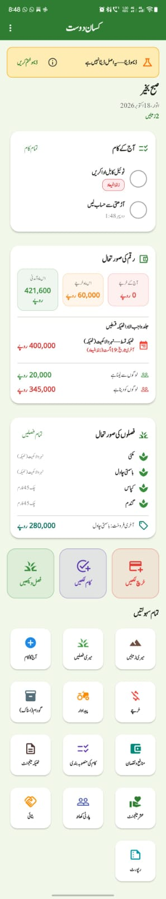 | 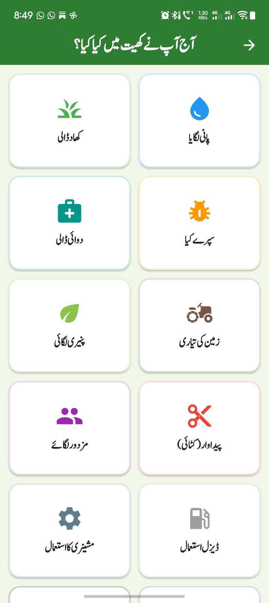 | 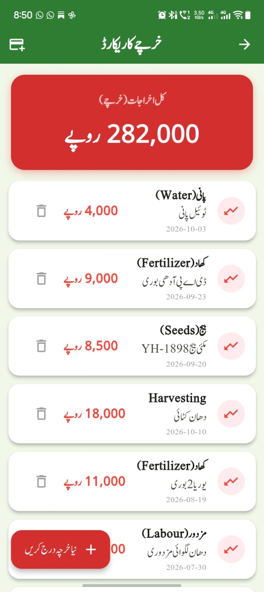 |

| Profit & Loss | Tasks & Alarms | Inventory |
| :---: | :---: | :---: |
| 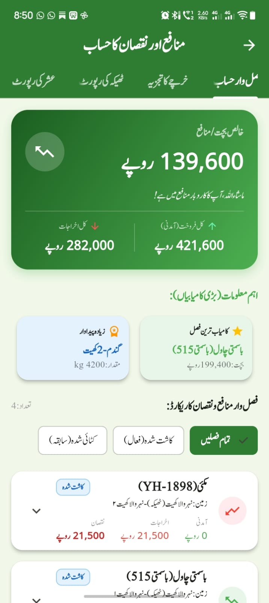 | 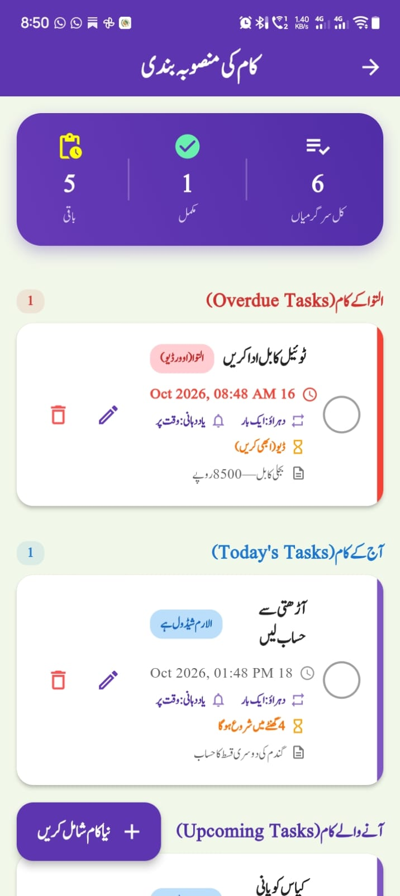 | 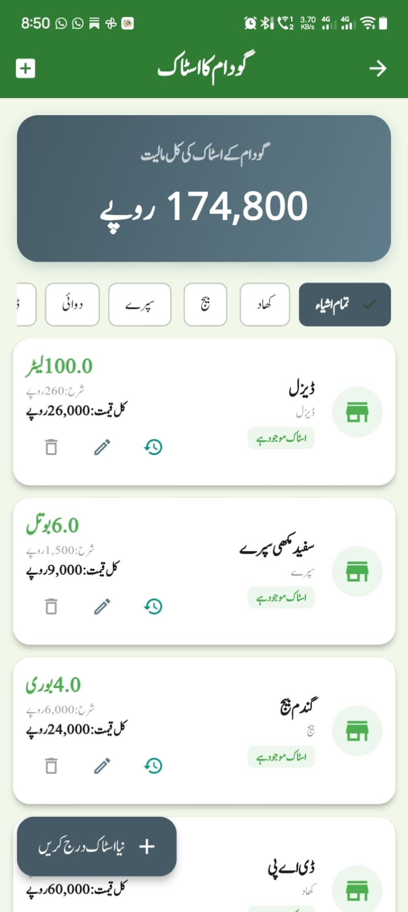 |

<details>
<summary>More screens</summary>

| Crops | Harvest & Sales | Party Ledger |
| :---: | :---: | :---: |
| 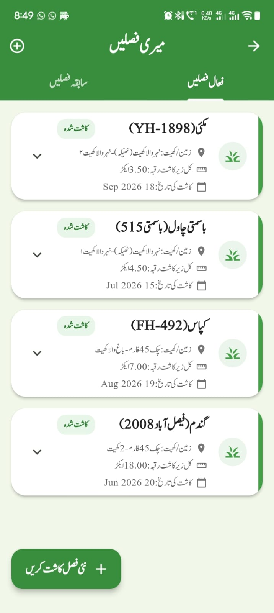 | 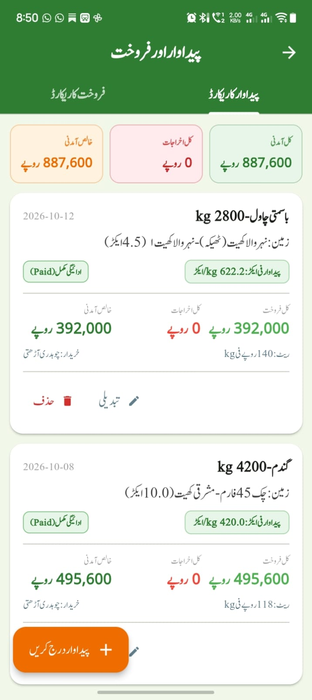 | 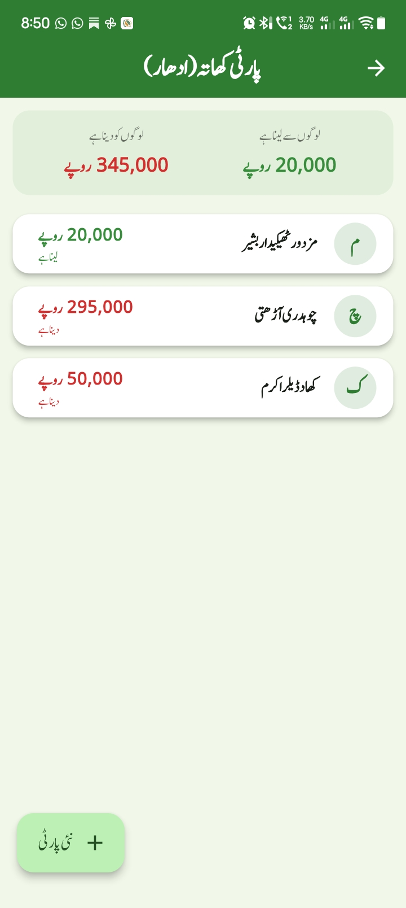 |

| Ushr | Theka | Batai |
| :---: | :---: | :---: |
| 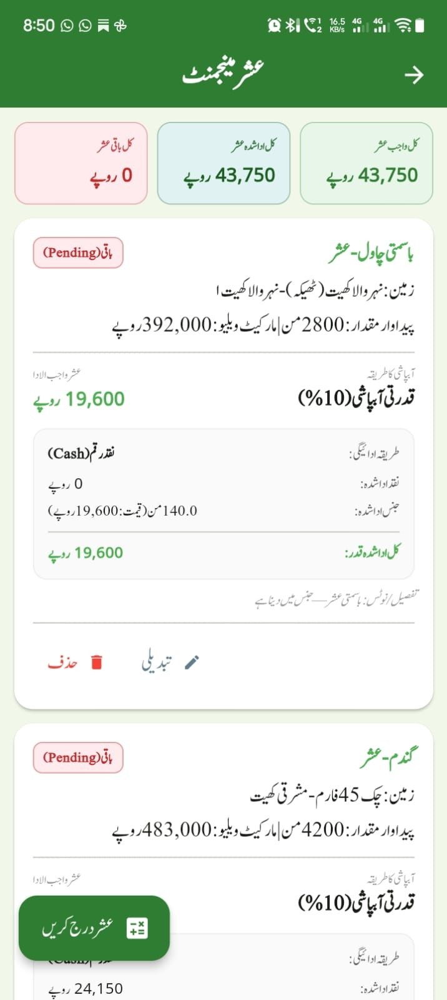 | 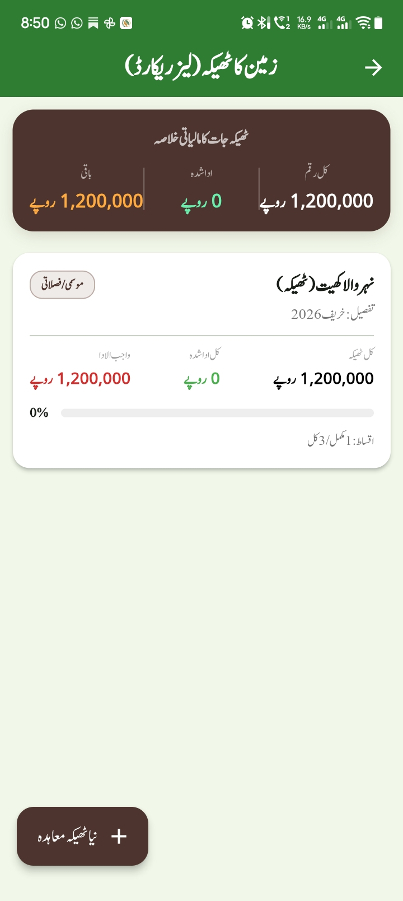 | 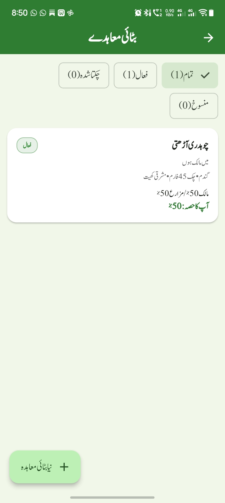 |

| Farms | Reports | Settings |
| :---: | :---: | :---: |
| 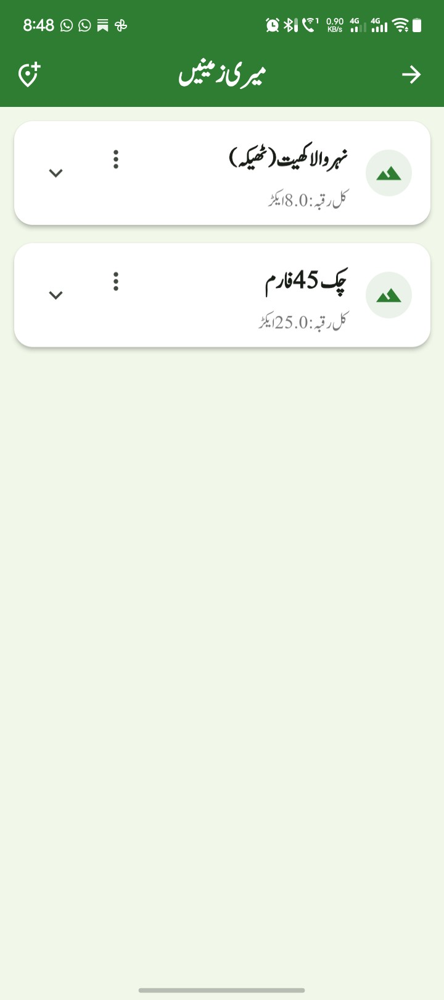 | 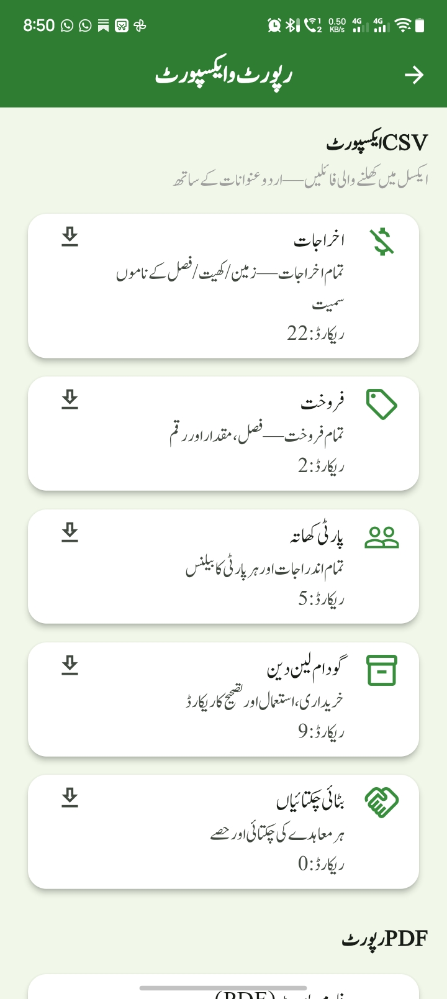 | 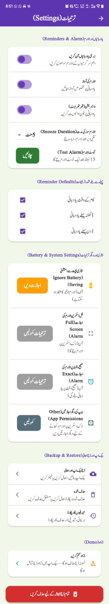 |

</details>

---

## 🌾 About (ایپ کے بارے میں)

**کسان دوست (Kisan Dost)** is a comprehensive, offline-first mobile application built with Flutter to empower farmers with seamless agricultural record-keeping and business analytics.

Designed with native **Urdu typography (Jameel Noori Nastaleeq)** and an intuitive **Right-to-Left (RTL)** layout, Kisan Dost replaces the paper diary. From sowing to harvest sales, profit & loss, and Islamic Ushr calculation — every rupee and every acre is tracked, with **zero internet required**.

---

## ✨ Key Features (اہم خصوصیات)

| Feature | Description |
| :--- | :--- |
| 🏡 **Farm Management (میرے فارمز)** | Register multiple farms, plots and acreages — owned or theka (leased). |
| 🌱 **Crop Lifecycle (میری فصلیں)** | Track sowing dates, seed varieties, expected harvest and growth status per season. |
| 📝 **Activity Logging (سرگرمیاں)** | Log irrigation, plowing, spraying, fertilizer and labour — with a smart form. |
| 💰 **Expense Tracking (اخراجات)** | Categorized expenses **linked to inventory**: pick a stock item, enter quantity (kg supported), cost auto-calculates, stock auto-deducts. |
| 🚜 **Harvest & Sales (پیداوار و فروخت)** | Record yields (maunds/kg), sale prices, buyers, mandi commission and receipts. |
| 📊 **Profit & Loss (نفع نقصان)** | Automatic 4-tab P&L: per crop, per farm, per season and overall. |
| 📜 **Theka Management (ٹھیکہ)** | Leased land contracts: dates, costs, installment schedules and balances. |
| 🤝 **Batai / Sharecropping (بٹائی)** | Owner/cultivator share agreements with exact-paisa harvest settlements. |
| 🤲 **Ushr Calculator (عشر)** | Islamic tithe: 10% (barani), 5% (irrigated) or custom, with cost deductions. |
| 📦 **Inventory / Warehouse (گودام)** | Append-only stock ledger, unit converter, consumption validation — no silent clamping. |
| 🤝 **Party Ledger / Udhaar (کھاتہ)** | Who owes whom: ادھار دیا / لیا / وصولی / ادائیگی with live balances. |
| ⏰ **Tasks & Alarms (الارم)** | Exact full-screen alarms (even on lock screen), snooze 5/10/15 min, reboot re-arm. |
| 📄 **Reports (رپورٹس)** | 5 CSV exports + 2 Urdu PDFs (P&L report, receipts). |
| 💾 **Backup & Restore (بیک اپ)** | Versioned, hash-verified backups; automatic daily backup; replace or merge restore. |
| 🗑️ **Recycle Bin + Audit Log** | Soft-delete on financial records, full audit trail — no silent data loss. |
| 🎭 **Demo Mode** | One-tap rich demo farm to explore every screen. |

---

## 🛠️ Technology Stack

| Layer | Technology |
| :--- | :--- |
| Framework | [Flutter](https://flutter.dev/) 3.7+ (Material 3, RTL) |
| Language | [Dart](https://dart.dev/) 3.0+ |
| Database | Local [SQLite](https://pub.dev/packages/sqflite) via `sqflite` (schema v15, 19 tables) |
| State Management | [Provider](https://pub.dev/packages/provider) |
| Alarms | `flutter_local_notifications` + native `AlarmManager.setAlarmClock` (Kotlin) |
| Documents | `pdf` package (Urdu rendered via app's own text engine) |
| Money | Integer paisa accounting (no float errors) |
| Typography | Jameel Noori Nastaleeq (Urdu display), Noto Sans (digits) |

### Architecture

```
lib/
├── main.dart            # Entry point, DI setup
├── screens/             # 28 screens (Urdu-first UI)
├── providers/           # 11 ChangeNotifier providers
├── services/            # Backup, export, PDF, notifications, demo data, P&L…
├── models/              # Data models
├── database/            # SQLite schema v15 + migrations
├── l10n/                # Urdu/English strings
├── widgets/             # Reusable UI components
└── utils/               # Error messages (friendly Urdu), helpers
android/app/src/main/kotlin/  # AlarmService, AlarmReceiver, AlarmScheduler
```

**Key design decisions:** fully offline (no `INTERNET` permission in release) • integer-paisa money • append-only inventory ledger • soft-delete + audit log • Asia/Karachi timezone for alarms • `SCHEDULE_EXACT_ALARM` + full-screen intent for reliable lock-screen alarms.

---

## 🚀 Getting Started

### Prerequisites

- [Flutter SDK](https://docs.flutter.dev/get-started/install) 3.7+
- Android SDK (compileSdk 36)
- JDK 17+

### Run in debug

```bash
git clone https://github.com/TalhaGoharWeb/KisanDost.git
cd KisanDost
flutter pub get
flutter run
```

### Build release APK

```bash
cd android
./gradlew assembleRelease --no-daemon
# → build/app/outputs/flutter-apk/app-release.apk
```

> Signing: release builds use `android/key.properties` + `kisandost-release.keystore`
> (both git-ignored). See `docs/RELEASE_SIGNING.md`.

### Tests

```bash
flutter test        # unit + widget tests
flutter analyze     # static analysis (0 errors)
```

---

## 📥 Download

| Version | Date | Size | SHA-256 |
| :--- | :--- | :--- | :--- |
| **1.0.6** | 2026-10-05 | 76.7 MB | `cf0de7a0…e36e` |

⬇ **[Download kisan-dost-1.0.6.apk](https://drive.google.com/uc?id=1taiPECFG5z9vVgBANVfHRRK8UMcUWbk9&export=download)**

<details>
<summary>Version history</summary>

| Version | Highlights |
| :--- | :--- |
| 1.0.6 | Expense→inventory link (pick stock item, auto cost, auto deduct); rich demo data |
| 1.0.5 | Rich realistic demo dataset covering all screens |
| 1.0.4 | **Alarm fix**: foreground service ordering — lock-screen alarms now ring |
| 1.0.3 | Snooze duration fix (Long vs Int); full-screen-intent permission prompt |
| 1.0.2 | Permission timing fix; test-alarm diagnostic; save confirmation |
| 1.0.1 | Hardened release (alarm sound kept, R8, production manifest) |
| 1.0.0 | Initial release — 14 roadmap phases |

</details>

---

## 🔒 Privacy & Security

- **100% offline** — no `INTERNET` permission in the release build; your data never leaves your phone.
- **No accounts, no analytics, no ads.**
- Local backups are checksummed (SHA-256) but **not encrypted** — keep backup files safe.
- Financial records are soft-deleted with an audit trail — nothing disappears silently.

---

## 🤝 Contributing

Issues and pull requests are welcome. Please keep the app's principles: **Urdu-first**, **offline-first**, **no silent data loss**, and friendly Urdu error messages (never raw exceptions).

---

## 📄 License

This project is proprietary. All rights reserved © Muhammad Talha Farid Farooqi.

---

<div align="center">

**کسان دوست** — آپ کی محنت کا حساب، آپ کے ہاتھ میں 🌾

[Website](https://talhagoharweb.github.io/KisanDost/) • [Releases](https://github.com/TalhaGoharWeb/KisanDost/releases)

</div>
